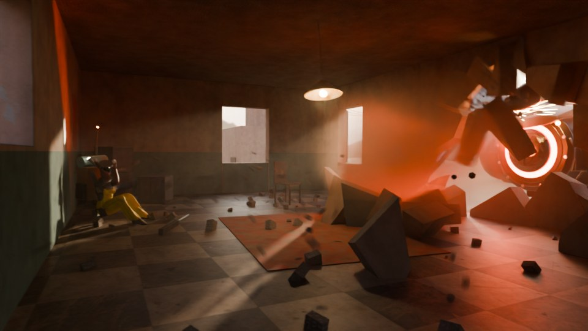
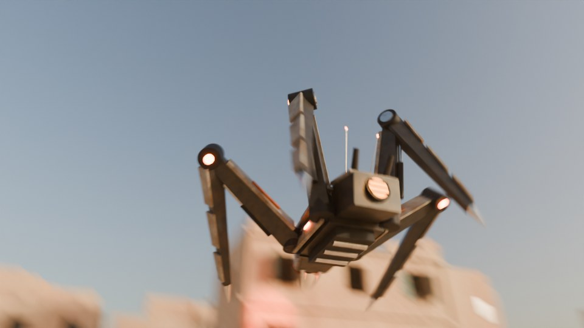
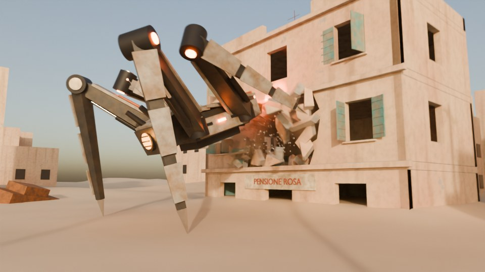
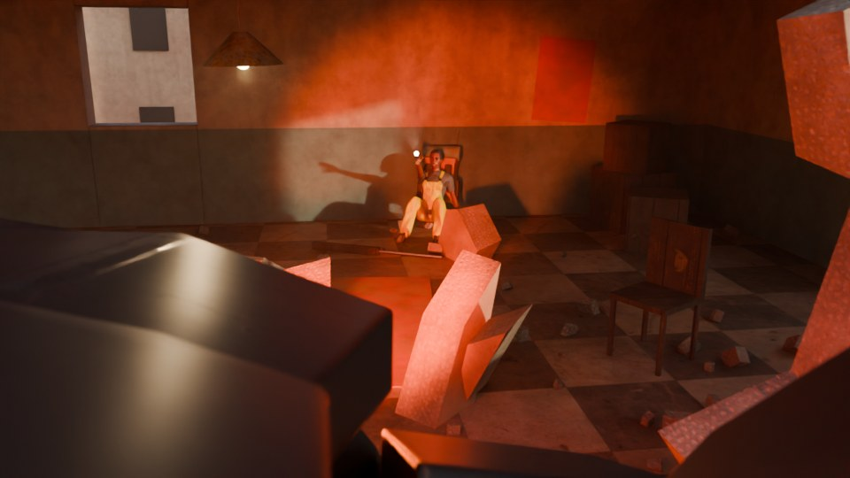
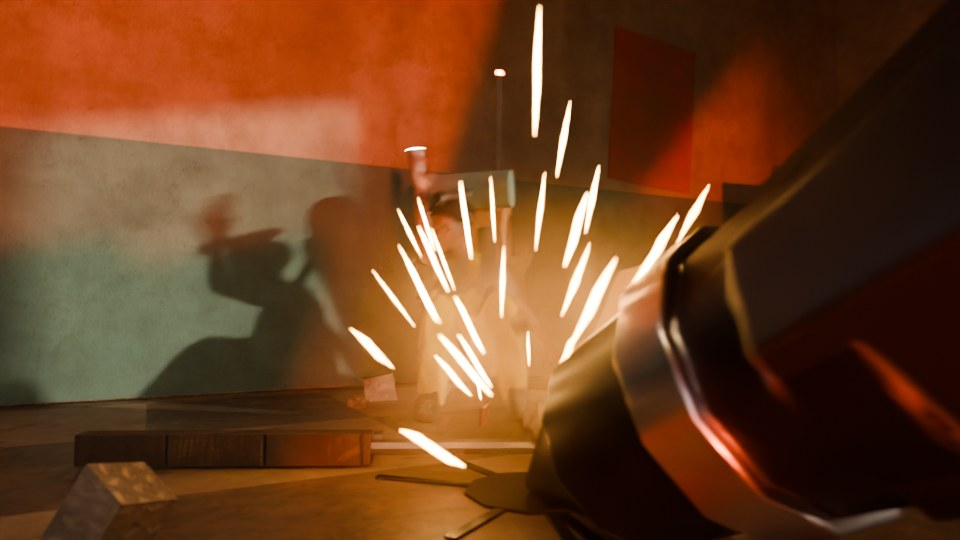

# ARC Raiders fan scene: "Leaper at the Wall"

A procedural Blender action scene. A **Leaper**, the big four-legged pouncing
ARC machine, leaps off a ruined tower and lands in the sand of a
Buried-City-style ruin. It then tears open the facade of an apartment block to
get at a terrified **Raider** cornered in a second-floor room.



| | |
|---|---|
|  |  |
|  |  |

Everything is generated by one Python script: terrain, buildings, a
pre-fractured wall, the IK-rigged Leaper, a posable Raider, interior props, the
dust/spark/debris FX, lighting, six cameras with handheld shake, and timeline
cuts. It uses no external assets or add-ons.

## Files

| File | What it is |
|---|---|
| `arc_raiders_leaper_attack.py` | The scene generator (source of truth) |
| `arc_raiders_leaper_attack.blend` | The same scene, pre-generated with Blender 4.5 LTS. Open it and render. |
| `previews/` | Low-sample preview stills |

## Shot list (24 fps, frames 1-288, about 12 s)

| # | Frames | Camera | Beat |
|---|---|---|---|
| 1 | 1-60 | `CAM_01_Exterior_Wide` | The Leaper pounces off a ruined tower, lands in a ring of sand, rears up and makes the first strike on the wall |
| 2 | 61-120 | `CAM_02_Interior_Corner` | Inside: the wall caves in. Two more strikes blow chunks across the room, and the Raider is knocked back and scrambles into the corner |
| 3 | 121-168 | `CAM_03_Exterior_Rip` | The Leaper hooks both forelegs into the breach and rips the wall out in one pull |
| 4 | 169-228 | `CAM_04_Leaper_POV` | Over the Leaper's back as it pushes its head into the hole. Its red searchlight sweeps the room and locks onto the Raider |
| 5 | 229-268 | `CAM_05_Floor_Level` | A foreleg spears through the breach and slams into the floor short of the Raider, then drags closer |
| 6 | 269-288 | `CAM_06_Raider_CloseUp` | Close on the Raider as the second stab lands even closer |

Cuts use timeline markers bound to cameras, so rendering the animation
switches cameras automatically.

## Running it

**In Blender:** open the `.blend` and render (F12 for a frame, Ctrl+F12 for
the animation). To regenerate, switch to the *Scripting* workspace, open
`arc_raiders_leaper_attack.py` and press *Run Script*. The script clears the
current scene first.

**From the command line** (arguments after `--` go to the script):

```bash
# build the scene and save it
blender -b --python arc_raiders_leaper_attack.py -- --save leaper_attack.blend

# quick half-res, low-sample stills of a few frames
blender -b --python arc_raiders_leaper_attack.py -- --preview --render-frames 22 100 146 205 250 284 --out ./stills

# full-quality image sequence (PNG) of all 288 frames
blender -b --python arc_raiders_leaper_attack.py -- --render-anim --out ./render

# use EEVEE instead of Cycles
blender --python arc_raiders_leaper_attack.py -- --engine EEVEE
```

Default output is 1920x1080, Cycles at 128 samples with denoising, motion
blur, depth of field and AgX color. The Cycles look was tuned for this scene;
EEVEE works, but its volumetrics and the searchlight beams look different.

Tested with **Blender 4.5 LTS** and **Blender 5.2**.

## What's in the scene

Collections under `ARC_LeaperAttack`:

- **Environment**: sand dunes, ten background ruins (including the launch
  tower), leaning utility poles with sagging cables, a buried rusted car,
  two ARC Wasp drones patrolling the skyline, and a thin haze volume.
- **Building**: the "Pensione Rosa" apartment block. Window openings are
  built from boxes rather than booleans, and it has shutters, a shop sign
  and roof clutter.
- **Debris**: the 2nd-floor facade, pre-cut into 64 convex chunks by
  recursive plane splits. Chunks hit by a strike fly into the room, nearby
  ones crack and shift, and the rip throws the rest outward. All motion is
  keyframed by a small ballistic solver (gravity, bounce, friction, room
  walls), so there is nothing to bake.
- **Interior**: overturned furniture, shelves, mattress, rug, the Raider's
  dropped rifle, rubble, a poster, a hanging lamp that swings and flickers
  after every hit, and dusty air so light beams show.
- **Leaper**: the armature `Leaper_Rig` (body, head, and four 2-bone IK legs
  with pole targets) drives one rigid-skinned hard-surface mesh. Details
  include armored carapace and leg plates, hydraulic pistons, knee lights,
  a glowing rear core, mandible spikes, and the red optic ringed by three
  armored eye plates. A red searchlight rides the head bone, and from frame
  ~190 the head locks on and tracks the Raider.
- **Raider**: a jointed puppet (empties named `RJ_*`) with a mustard jacket,
  chest rig, oversized backpack with bedroll and radio antenna, helmet with
  goggles, a respirator, and a working flashlight in the right hand. Poses
  include crouch, flinch, scramble, cower, aim and terror, with fear-scaled
  trembling and breathing.
- **FX**: volumetric dust puffs, spark and gravel particle bursts, tile
  shards, ceiling dust, and floor-crack decals at the stab points.
- **Lights / Cameras**: a golden-hour sun matched to the sky texture, the
  six shot cameras, and per-shot exposure keys.

## Tweaking

All choreography lives in plain data near the top of each section:

- `WALL_HITS`, `HOOKS`, `RIP_F`, `STABS`, `SHAKES`: the action beats.
  The wall fracture, FX and camera shake all read from these.
- `BODY`, `HEAD`, `FOOT_KEYS`: the Leaper's body path, head scan and foot
  targets. Each is a list of `(frame, value, ease)` keys. Easing codes:
  `s` smooth, `i` ease-in (strikes), `o` ease-out, `l` linear, `h` hold.
- `RAIDER_POSES`, `RAIDER_POSE_KEYS`, `RAIDER_ROOT`, `FEAR`: the Raider's
  acting.
- `SHOTS`: camera paths, look-at targets, lens, aperture and exposure.
- `SAMPLES`, `RESOLUTION`, `MOTION_BLUR`, `EXTERIOR_HAZE`, `ROOM_DUST`:
  render cost versus quality.

Animation is baked to keyframes on every frame, so you can also hand-edit it
in the Graph Editor after generating.

---

Fan work. ARC Raiders and the Leaper belong to Embark Studios. Every model
here is an original approximation built from primitives; no game assets
are used.
