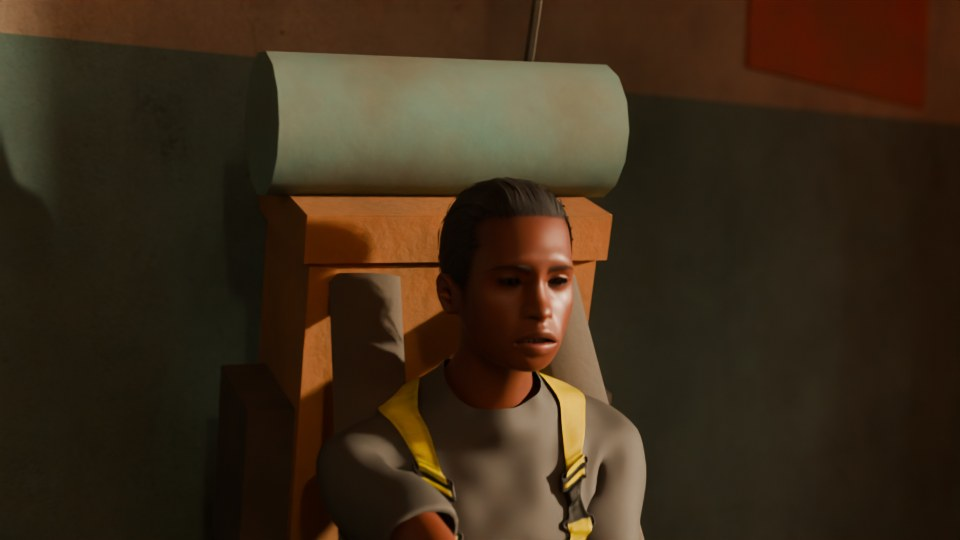
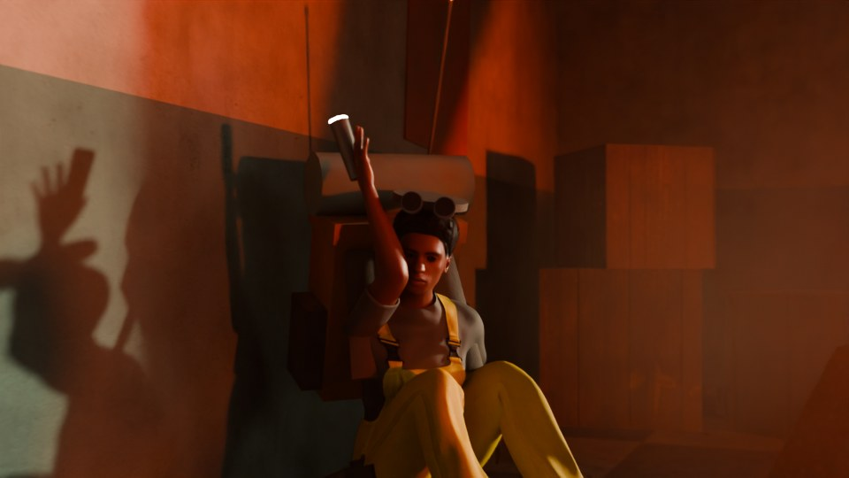

# ARC Raiders fan scene: "Leaper at the Wall"

A Blender action scene. A **Leaper**, the big four-legged pouncing ARC
machine, leaps off a ruined tower and lands in the sand of a Buried-City-style
ruin. It then tears open the facade of an apartment block to get at a
terrified **Raider** cornered in a second-floor room.


| | |
|---|---|
|  |  |
|  |  |
|  |  |

A low-res flipbook of all 288 frames is in [`previews/flipbook_lowres.mp4`](previews/flipbook_lowres.mp4).

One Python script builds everything: terrain, buildings, a pre-fractured
wall, the IK-rigged Leaper, the Raider, interior props, the dust, spark and
debris FX, lighting, six cameras with handheld shake, and timeline cuts. For
photorealism it pulls in **free CC0 assets**: Poly Haven photo textures and a
desert HDRI sky, plus a realistic MakeHuman body for the Raider via the MPFB
add-on, with an animated facial performance built from ARKit face units.
Without network access it falls back to fully procedural shading and a
primitive Raider.

## Files

| File | What it is |
|---|---|
| `arc_raiders_leaper_attack.py` | The scene generator (source of truth) |
| `arc_raiders_leaper_attack.blend` | The photoreal scene, pre-generated with Blender 4.5 LTS, with all textures packed (~42 MB). Open it and render; no add-ons needed. |
| `previews/` | Preview stills (960x540, 64 samples) and a low-res flipbook of the whole sequence |

## Shot list (24 fps, frames 1-288, about 12 s)

| # | Frames | Camera | Beat |
|---|---|---|---|
| 1 | 1-60 | `CAM_01_Exterior_Wide` | The Leaper pounces off a ruined tower, lands in a ring of sand, rears up and makes the first strike on the wall |
| 2 | 61-96 | `CAM_02_Interior_Corner` | Inside: the wall caves in. A second strike blows chunks across the room, and the Raider is knocked back and scrambles into the corner |
| 3 | 97-120 | `CAM_03_Raider_Reaction` | Close on her face as the third strike lands: she flinches, then stares at the breach, terrified |
| 4 | 121-168 | `CAM_04_Exterior_Rip` | The Leaper hooks both forelegs into the breach and rips the wall out in one pull |
| 5 | 169-228 | `CAM_05_Leaper_POV` | Just outside the breach, past the Leaper's head, as it pushes into the hole. Its red searchlight sweeps the room and locks onto the Raider |
| 6 | 229-268 | `CAM_06_Floor_Level` | A foreleg spears through the breach and slams into the floor short of the Raider, then drags closer |
| 7 | 269-288 | `CAM_07_Raider_CloseUp` | Close on the Raider, panicking and then screaming as the second stab lands even closer |

Cuts use timeline markers bound to cameras, so rendering the animation
switches cameras automatically.

## Running it

**In Blender:** open the `.blend` and render (F12 for a frame, Ctrl+F12 for
the animation). To regenerate, switch to the *Scripting* workspace, open
`arc_raiders_leaper_attack.py` and press *Run Script*. The script clears the
current scene first.

**From the command line** (arguments after `--` go to the script):

```bash
# build the scene (downloads free textures + HDRI on first run) and save it
blender -b --python arc_raiders_leaper_attack.py -- --save leaper_attack.blend

# same, but also install MPFB + MakeHuman assets for the realistic Raider,
# and pack every image into the .blend so it is self-contained
blender -b --python arc_raiders_leaper_attack.py -- --install-mpfb --pack --save leaper_attack.blend

# quick half-res, low-sample stills of a few frames
blender -b --python arc_raiders_leaper_attack.py -- --preview --render-frames 22 100 146 205 250 284 --out ./stills

# full-quality image sequence (PNG) of all 288 frames
blender -b --python arc_raiders_leaper_attack.py -- --render-anim --out ./render

# fully procedural, no downloads; or EEVEE instead of Cycles
blender --python arc_raiders_leaper_attack.py -- --assets off
blender --python arc_raiders_leaper_attack.py -- --engine EEVEE
```

| Option | Effect |
|---|---|
| `--assets auto` (default) / `off` | Download and use the CC0 textures and HDRI (and MPFB if installed), or stay procedural |
| `--install-mpfb` | Download and enable the MPFB add-on and the MakeHuman CC0 asset pack (~280 MB, once). The face-unit pack (0.3 MB) is fetched into the cache automatically. |
| `--tex-res 1k/2k/4k` | Poly Haven texture resolution (default 1k) |
| `--asset-dir PATH` | Download cache (default: Blender's user `datafiles/arc_leaper_assets`) |
| `--pack` | Pack all images into the saved `.blend` |

If you'd rather install MPFB yourself: *Edit > Preferences > Get
Extensions*, search **MPFB**, install it, then load
`makehuman_system_assets_cc0.zip` in MPFB's *Apply Assets* panel. The script
picks it up automatically on the next run.

Default output is 1920x1080, Cycles at 128 samples with denoising, motion
blur, depth of field and AgX color. The Cycles look was tuned for this scene.
EEVEE works, but its volumetrics, searchlight beams and armor edge wear look
different.

Tested with **Blender 4.5 LTS** and **Blender 5.2**, with and without the
downloaded assets.

## What's in the scene

Collections under `ARC_LeaperAttack`:

- **Environment**: sand dunes, ten background ruins (including the launch
  tower), leaning utility poles with sagging cables, a buried rusted car,
  two ARC Wasp drones patrolling the skyline, and a thin haze volume. The
  sky is a golden-hour desert HDRI, rotated so its sun lines up with the
  scene's sun lamp.
- **Building**: the "Pensione Rosa" apartment block, with photo-textured
  plaster, painted interior walls, concrete and tiled floors. Procedural
  rain streaks, grime and flaked patches are layered on top. Window
  openings are built from boxes rather than booleans, and it has shutters,
  a shop sign and roof clutter.
- **Debris**: the 2nd-floor facade, pre-cut into 64 convex chunks by
  recursive plane splits. Chunks hit by a strike fly into the room, nearby
  ones crack and shift, and the rip throws the rest outward. All motion is
  keyframed by a small ballistic solver (gravity, bounce, friction, room
  walls), so there is nothing to bake.
- **Interior**: overturned furniture, shelves, mattress, rug, the Raider's
  dropped rifle, rubble, a poster, a hanging lamp that swings and flickers
  after every hit, and dusty air so light beams show.
- **Leaper**: modeled after the ARC Raiders key art. It has a compact
  armored core with one big bolted optic (black glass lens, glowing red
  ring) and four massive faceted legs: high hexagonal knee joints with
  status lights, hydraulic pistons, cable runs, push rods and piston feet.
  The armor is a scanned painted-metal texture recolored to dark gunmetal,
  with edges worn to bare steel and grime in the crevices. The armature
  `Leaper_Rig` (body, head, and four 2-bone IK legs with pole targets)
  drives the mesh. A searchlight rides the head bone, and from frame ~190
  the head locks on and tracks the Raider.
- **Raider**: the acting lives on a jointed puppet (empties named `RJ_*`):
  crouch, flinch, scramble, cower, aim and terror poses, with fear-scaled
  trembling and breathing, and an automatic floor-contact fix. With MPFB
  available, a realistic MakeHuman woman (subsurface skin, brown eyes,
  teeth and tongue, slicked-back hair, a work suit recolored
  scavenger-mustard, boots) is generated and her game rig is baked from the
  puppet every frame. She wears the kit: a big backpack with bedroll and
  radio antenna, belt pouches, and a working flashlight. Without MPFB, the
  puppet wears primitive body parts instead.
- **Facial performance** (realistic Raider only): 33 ARKit face units are
  loaded as shape keys and carried over to her eyes, brows, lashes, teeth
  and tongue. They play a scripted performance: alert, flinching at each
  impact, panicking while she scrambles, whimpering, wide-eyed terror when
  the searchlight finds her, and screaming at both stabs. On top run
  procedural blinks (faster when she's scared), panicked breathing, and eye
  gaze that tracks the threat: the bulging wall, then the Leaper's optic,
  then the leg.
- **FX**: volumetric dust puffs, spark and gravel particle bursts, tile
  shards, ceiling dust, and floor-crack decals at the stab points.
- **Lights / Cameras**: the sun lamp, the six shot cameras, and per-shot
  exposure keys.

## Tweaking

All choreography lives in plain data near the top of each section:

- `WALL_HITS`, `HOOKS`, `RIP_F`, `STABS`, `SHAKES`: the action beats.
  The wall fracture, FX and camera shake all read from these.
- `BODY`, `HEAD`, `FOOT_KEYS`: the Leaper's body path, head scan and foot
  targets. Each is a list of `(frame, value, ease)` keys. Easing codes:
  `s` smooth, `i` ease-in (strikes), `o` ease-out, `l` linear, `h` hold.
- `RAIDER_POSES`, `RAIDER_POSE_KEYS`, `RAIDER_ROOT`, `FEAR`: the Raider's
  acting.
- `FACE`, `FACE_KEYS`: facial expressions as weights of ARKit face units
  (`browInnerUp`, `eyeWide*`, `jawOpen`, ...; `*` means both sides) and
  when they play.
- `RAIDER_HUMAN`: the MakeHuman recipe (body shape, skin, hair, clothes),
  using any asset name from the MakeHuman system pack.
- `POLYHAVEN_TEX`, `HDRI_ID`: swap in any Poly Haven texture or HDRI by its id.
- `SHOTS`: camera paths, look-at targets, lens, aperture and exposure.
- `SAMPLES`, `RESOLUTION`, `MOTION_BLUR`, `EXTERIOR_HAZE`, `ROOM_DUST`:
  render cost versus quality.

Animation is baked to keyframes on every frame, so you can also hand-edit it
in the Graph Editor after generating.

## Credits and licenses

| Asset | Source | License |
|---|---|---|
| Textures: `painted_plaster_wall`, `chipped_concrete`, `floor_tiles_06`, `dense_sand`, `weathered_planks`, `rusty_metal_02`, `blue_metal_plate` | [Poly Haven](https://polyhaven.com) | CC0 |
| HDRI: `klippad_sunrise_2` | [Poly Haven](https://polyhaven.com/a/klippad_sunrise_2) | CC0 |
| Body, skin, eyes, hair, teeth, tongue, work suit, boots | [MakeHuman system assets](https://static.makehumancommunity.org/assets/assetpacks.html) | CC0 |
| ARKit face units (`faceunits01`, by Mika Suominen) | [MakeHuman asset packs](https://static.makehumancommunity.org/assets/assetpacks/faceunits01.html) | CC0 |
| Human generator add-on (used at build time, not redistributed) | [MPFB](https://extensions.blender.org/add-ons/mpfb/) | GPL-3.0 |

Fan work. ARC Raiders and the Leaper belong to Embark Studios. The Leaper
and Raider are original models built for this scene with reference to
public key art; no game assets are used.
